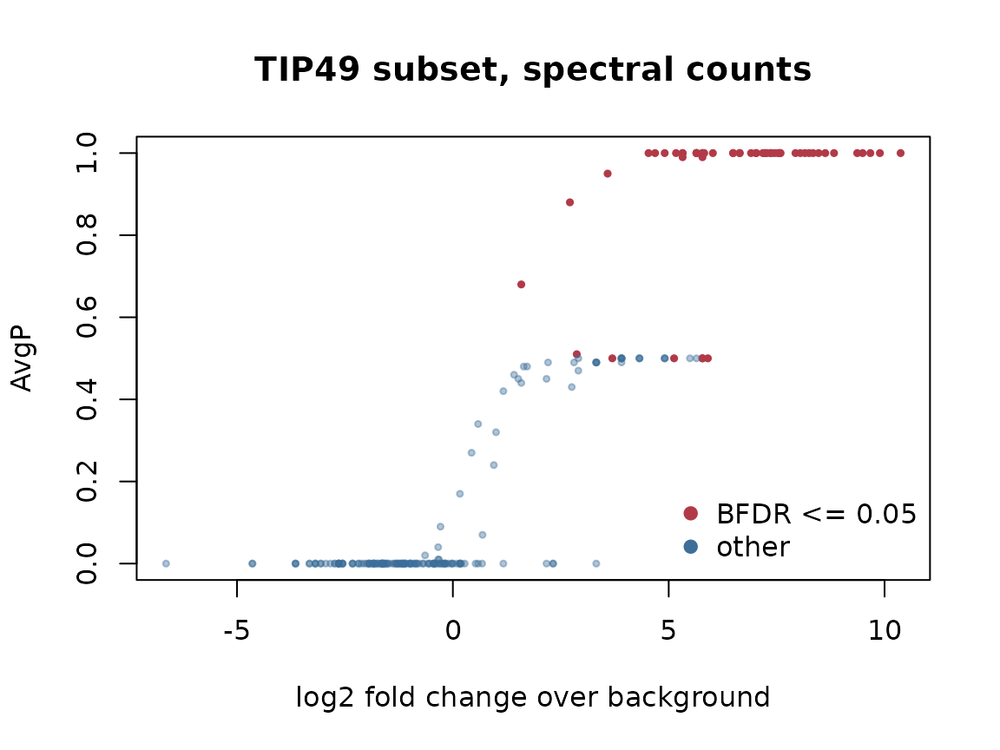

# Scoring AP-MS interactions with SAINTexpress

## Introduction

In an affinity purification-mass spectrometry (AP-MS) experiment, a
tagged protein, the *bait*, is purified from cell lysate together with
the proteins bound to it, and mass spectrometry identifies and
quantifies these *preys*. Most preys in a purification are not genuine
interaction partners: abundant proteins, proteins binding the beads or
the tag, and carry-over appear in almost every purification.
Negative-control purifications, without the bait or with the tag alone,
show what this background looks like.

SAINT (Significance Analysis of INTeractome, Choi et al. 2011) scores
each bait-prey pair. It models the abundance of a prey in the
purifications of a bait as coming either from a true interaction or from
the background, estimates the background distribution of each prey from
the negative controls, and returns the probability that the interaction
is true (`AvgP`) and a Bayesian false discovery rate (`BFDR`).
SAINTexpress (Teo et al. 2014) is the faster, simplified implementation
of SAINT. It has a model for spectral counts and one for intensities,
and can use known prey-prey interactions as a prior.

Use SAINT when you have AP-MS (or proximity labelling) data with
negative controls and want to separate interaction partners of each bait
from background, for example to filter interactions at `BFDR <= 0.05`
before building a network. SAINT does not compare abundances between
conditions; that is a differential-expression question.

SAINTexpress has so far been available as a C++ program, run outside R
on text files. This package implements both of its models in R, so
interaction scoring can be part of an R analysis, run on every platform,
and start from data already loaded in R, as a matrix or a long table
(see the last sections). The scores agree with the native SAINTexpress
3.6.3 program (see below).

Related packages:

- **artMS** converts MaxQuant results into the input files of
  SAINTexpress (`artmsEvidenceToSaintExpress()`); the scoring itself
  then needs the native program. This package scores these tables
  directly in R.
- **apComplex** estimates protein complex membership, as a bipartite
  graph of proteins and complexes, from bait-prey observations. It
  answers a different question: which proteins form complexes, rather
  than how likely each single bait-prey interaction is. Interactions
  filtered by SAINT can be its input.

## The TIP49 data

The package ships a subset of the example data of SAINTexpress, an AP-MS
experiment on human protein complexes containing TIP49a/TIP49b
(RUVBL1/RUVBL2) with spectral counts (Sardiu et al. 2008). The subset
keeps 4 baits (ACTR8, ZNHIT1, INO80B, VPS72) in 7 purifications, all 9
negative controls, and the 78 preys seen in at least 3 bait
purifications (`inst/scripts/tip49.md`). The files are the headerless
tables native SAINTexpress reads.

``` r
library(SAINTexpress)
tip49 <- system.file("extdata", "tip49", package = "SAINTexpress")
read_dat <- function(file) {
  read.delim(file.path(tip49, file), header = FALSE, stringsAsFactors = FALSE)
}
si <- list(
  inter = read_dat("inter.dat"),
  prey = read_dat("prey.dat"),
  bait = read_dat("bait.dat")
)
lapply(si, head, 3)
#> $inter
#>       V1    V2     V3 V4
#> 1 ARP8_1 ACTR8  ACTR5 10
#> 2 ARP8_1 ACTR8 RUVBL2 16
#> 3 ARP8_1 ACTR8 RUVBL1 38
#> 
#> $prey
#>       V1  V2
#> 1  ACTR5 607
#> 2 RUVBL2 463
#> 3 RUVBL1 456
#> 
#> $bait
#>       V1     V2 V3
#> 1 ARP8_1  ACTR8  T
#> 2 ARP8_2  ACTR8  T
#> 3   Ies2 INO80B  T
```

[`run_saint()`](https://prolfqua.github.io/SAINTexpress/reference/run_saint.md)
takes a list of three data frames. Their columns are matched by name
when all required names are present, otherwise by position, as here.

| Table | Column | Type | Content |
|----|----|----|----|
| `inter` | `ipId` | character | Purification (IP) |
|  | `baitId` | character | Bait of the IP |
|  | `preyId` | character | Prey |
|  | `quant` | numeric | Spectral count (whole number \>= 0) or intensity (\> 0) |
| `prey` | `preyId` | character | Prey, unique |
|  | `preyLength` | numeric | Protein length (optional, not used) |
|  | `preyGeneId` | character | Gene name (optional, defaults to `preyId`) |
| `bait` | `ipId` | character | Purification, unique |
|  | `baitId` | character | Bait; replicate IPs share it |
|  | `CorT` | character | `T` for a bait IP, `C` for a negative control |

[`validate_saint_input()`](https://prolfqua.github.io/SAINTexpress/reference/validate_saint_input.md)
checks the tables. If it passes,
[`run_saint()`](https://prolfqua.github.io/SAINTexpress/reference/run_saint.md)
accepts them; otherwise it names the table and column at fault.

``` r
validate_saint_input(si, mode = "spc")
```

## Spectral-count scoring

``` r
scores <- run_saint(si, mode = "spc")
dim(scores)
#> [1] 237  17
names(scores)
#>  [1] "Bait"          "Prey"          "PreyGene"      "Spec"         
#>  [5] "SpecSum"       "AvgSpec"       "NumReplicates" "ctrlCounts"   
#>  [9] "AvgP"          "MaxP"          "TopoAvgP"      "TopoMaxP"     
#> [13] "SaintScore"    "logOddsScore"  "FoldChange"    "BFDR"         
#> [17] "boosted_by"
```

Each row is a bait-prey pair. The columns follow the native `list.txt`:

| Column | Content |
|----|----|
| `Spec`, `SpecSum`, `AvgSpec`, `NumReplicates` | Prey counts in the replicate IPs of the bait, their sum and mean, number of replicates |
| `ctrlCounts` | Prey counts in the control IPs |
| `AvgP`, `MaxP` | Probability of a true interaction, averaged over replicates and the highest one |
| `TopoAvgP`, `TopoMaxP`, `SaintScore`, `boosted_by` | Scores with the prey-prey prior (see below) |
| `logOddsScore` | Lowest replicate log odds of true vs background |
| `FoldChange` | Mean count divided by the background mean |
| `BFDR` | Bayesian false discovery rate |

The highest-scoring preys of the bait ZNHIT1 include the other subunits
of the SRCAP chromatin-remodelling complex it belongs to, such as SRCAP,
ACTR6, DMAP1, RUVBL1, RUVBL2, YEATS4 and VPS72, all absent or nearly
absent from the controls:

``` r
znhit1 <- scores[scores$Bait == "ZNHIT1", ]
head(znhit1[order(-znhit1$AvgP, -znhit1$FoldChange),
            c("Prey", "Spec", "ctrlCounts", "AvgP", "FoldChange", "BFDR")], 10)
#>          Prey    Spec        ctrlCounts AvgP FoldChange BFDR
#> 223     SRCAP  190|75 0|0|0|0|0|0|0|0|0    1    1325.00    0
#> 216     ACTR6   69|63 0|0|0|0|0|0|0|0|0    1     660.00    0
#> 171    ACTL6A   54|37 0|0|0|0|0|0|0|0|0    1     455.00    0
#> 226     DMAP1   54|25 0|0|0|0|0|0|0|0|0    1     395.00    0
#> 173      ACTB   38|19 0|0|0|0|0|0|0|0|0    1     285.00    0
#> 170    RUVBL1 138|162 3|2|0|0|0|0|0|2|0    1     192.86    0
#> 169    RUVBL2 125|147 6|0|1|0|0|0|0|0|0    1     174.86    0
#> 222    YEATS4    26|7 0|0|0|0|0|0|0|0|0    1     165.00    0
#> 225     VPS72   14|17 0|0|0|0|0|0|0|0|0    1     155.00    0
#> 185 HIST1H2BJ    7|17 0|0|0|0|0|0|0|0|0    1     120.00    0
```

At a Bayesian FDR of 5%:

``` r
hits <- scores[scores$BFDR <= 0.05, ]
nrow(hits)
#> [1] 56
head(sort(table(hits$Bait), decreasing = TRUE))
#> 
#>  VPS72 INO80B ZNHIT1  ACTR8 
#>     20     13     13     10
```

``` r
is_hit <- scores$BFDR <= 0.05
plot(
  log2(scores$FoldChange), scores$AvgP,
  pch = 19, cex = 0.5,
  col = ifelse(is_hit, "#B23A48", "#3D6F9966"),
  xlab = "log2 fold change over background", ylab = "AvgP",
  main = "TIP49 subset, spectral counts"
)
legend("bottomright", legend = c("BFDR <= 0.05", "other"),
       col = c("#B23A48", "#3D6F99"), pch = 19, bty = "n")
```



## Intensity scoring

`mode = "int"` uses the SAINTexpress intensity model: intensities are
log transformed and standardised, and both the true and the background
distribution are normal. Here the TIP49 counts stand in for intensities,
as in the SAINTexpress example.

``` r
scores_int <- run_saint(si, mode = "int")
head(scores_int[order(-scores_int$AvgP),
                c("Bait", "Prey", "AvgIntensity", "AvgP", "BFDR")])
#>       Bait   Prey AvgIntensity  AvgP  BFDR
#> 170 ZNHIT1 RUVBL1        9.562 0.993 0.000
#> 105  VPS72 RUVBL1        9.415 0.991 0.007
#> 169 ZNHIT1 RUVBL2        8.870 0.987 0.008
#> 104  VPS72 RUVBL2        7.080 0.959 0.010
#> 3    ACTR8 RUVBL1        3.733 0.638 0.017
#> 223 ZNHIT1  SRCAP        8.546 0.516 0.086
```

## Agreement with native SAINTexpress

`inst/extdata/tip49` also holds the `list.txt` files written by the
native SAINTexpress 3.6.3 programs for these inputs
(`inst/scripts/tip49.md` describes how). The R scores agree with them;
the package tests check this for both models and both optimizers.

``` r
native_diff <- function(r_scores, file) {
  native <- read.delim(file.path(tip49, file), stringsAsFactors = FALSE)
  both <- merge(native, r_scores, by = c("Bait", "Prey"), suffixes = c("_native", "_r"))
  vapply(c("AvgP", "MaxP", "SaintScore", "BFDR"), function(column) {
    max(abs(both[[paste0(column, "_native")]] - both[[paste0(column, "_r")]]))
  }, numeric(1))
}
rbind(
  spc = native_diff(scores, "list_spc.txt"),
  int = native_diff(scores_int, "list_int.txt")
)
#>      AvgP  MaxP SaintScore  BFDR
#> spc 0.000 0.000      0.000 0.000
#> int 0.001 0.001      0.001 0.016
```

The spectral-count scores match the native output exactly (both are
rounded to two decimals). The intensity scores differ by a few
thousandths in the probabilities and by up to 0.02 in BFDR, from small
numerical differences between the two implementations of the intensity
model.

## Optimizer and tuning arguments

**`optimizer`**. The model parameters are fitted by maximum likelihood.
`"base"` (default) uses
[`stats::optim()`](https://rdrr.io/r/stats/optim.html) with method
L-BFGS-B. `"nloptr"` uses the COBYLA algorithm of the NLopt library,
like native SAINTexpress, and needs the nloptr package. Both give nearly
the same scores:

``` r
if (requireNamespace("nloptr", quietly = TRUE)) {
  scores_nloptr <- run_saint(si, mode = "spc", optimizer = "nloptr")
  max(abs(scores_nloptr$AvgP - scores$AvgP))
}
#> [1] 0
```

**`R`** (default 100) is the most replicates averaged into `AvgP`: with
`R = 1`, `AvgP` is the probability of the best replicate, equal to
`MaxP`. This rewards interactions seen strongly in a single replicate.

``` r
scores_r1 <- run_saint(si, mode = "spc", R = 1)
all(scores_r1$AvgP == scores_r1$MaxP)
#> [1] TRUE
c(default = sum(scores$BFDR <= 0.05), R1 = sum(scores_r1$BFDR <= 0.05))
#> default      R1 
#>      56      93
```

**`L`** (default 100, spectral counts only) is the number of control IPs
used for the background of each prey: for every prey the `L` controls
with the highest counts are taken. A smaller `L` makes the background
stricter when some controls are much cleaner than others. TIP49 has 9
controls, so the default uses all of them.

``` r
scores_l4 <- run_saint(si, mode = "spc", L = 4)
c(default = sum(scores$BFDR <= 0.05), L4 = sum(scores_l4$BFDR <= 0.05))
#> default      L4 
#>      56      54
```

**`p2p_mapping`** gives known prey-prey interactions, for example from
protein complex databases. A prey whose known partners are also detected
with the bait gets a higher topology score `TopoAvgP`; `SaintScore` is
the larger of `AvgP` and `TopoAvgP`, and `boosted_by` lists the
partners. The mapping is a list with one element per row of the prey
table, holding the row numbers of the linked preys. Here, members of the
INO80 and SRCAP complexes are linked:

``` r
complexes <- list(
  INO80 = c("RUVBL1", "RUVBL2", "ACTR5", "ACTR8", "INO80B", "INO80C", "INO80D",
            "INO80E", "NFRKB", "TFPT", "MCRS1", "UCHL5", "YY1", "ACTL6A"),
  SRCAP = c("SRCAP", "ZNHIT1", "VPS72", "H2AFZ", "DMAP1", "ACTL6A", "RUVBL1",
            "RUVBL2")
)
prey_ids <- si$prey[[1]]
p2p_mapping <- lapply(prey_ids, function(prey) {
  partners <- unlist(complexes[vapply(complexes, function(x) prey %in% x, logical(1))])
  match(setdiff(unique(partners), prey), prey_ids)
})
scores_topo <- run_saint(si, mode = "spc", p2p_mapping = p2p_mapping)
boosted <- scores_topo[scores_topo$TopoAvgP > scores_topo$AvgP, ]
head(boosted[, c("Bait", "Prey", "AvgP", "TopoAvgP", "SaintScore", "boosted_by")])
#>       Bait   Prey AvgP TopoAvgP SaintScore
#> 45   ACTR8  H2AFZ 0.42      0.5        0.5
#> 76  INO80B    YY1 0.95      1.0        1.0
#> 103  VPS72  ACTR5 0.99      1.0        1.0
#> 106  VPS72 INO80C 0.49      0.5        0.5
#> 107  VPS72  ACTR8 0.99      1.0        1.0
#> 121  VPS72    YY1 0.47      0.5        0.5
#>                                                                               boosted_by
#> 45                                        SRCAP|ZNHIT1|VPS72|DMAP1|ACTL6A|RUVBL1|RUVBL2|
#> 76  RUVBL1|RUVBL2|ACTR5|ACTR8|INO80B|INO80C|INO80D|INO80E|NFRKB|TFPT|MCRS1|UCHL5|ACTL6A|
#> 103   RUVBL1|RUVBL2|ACTR8|INO80B|INO80C|INO80D|INO80E|NFRKB|TFPT|MCRS1|UCHL5|YY1|ACTL6A|
#> 106    RUVBL1|RUVBL2|ACTR5|ACTR8|INO80B|INO80D|INO80E|NFRKB|TFPT|MCRS1|UCHL5|YY1|ACTL6A|
#> 107   RUVBL1|RUVBL2|ACTR5|INO80B|INO80C|INO80D|INO80E|NFRKB|TFPT|MCRS1|UCHL5|YY1|ACTL6A|
#> 121 RUVBL1|RUVBL2|ACTR5|ACTR8|INO80B|INO80C|INO80D|INO80E|NFRKB|TFPT|MCRS1|UCHL5|ACTL6A|
```

## From a quantity matrix, sample table and feature table

Quantitative data are often at hand as a matrix of spectral counts or
intensities, with preys in rows and IPs in columns, together with a
sample table describing the IPs and a feature table describing the
preys. These are also the pieces a `SummarizedExperiment` returns with
`assay()`, `colData()` and `rowData()`.

We start from these three pieces for a small experiment: two baits with
two IPs each and two control IPs. `P1` and `P2` bind `BaitA`, `P3` and
`P4` bind `BaitB`, `P5` and `P6` are background.

``` r
row_data <- data.frame(
  protein = c("P1", "P2", "P3", "P4", "P5", "P6"),
  gene = c("GENE1", "GENE2", "GENE3", "GENE4", "GENE5", "GENE6")
)
col_data <- data.frame(
  sample = c("IP1", "IP2", "IP3", "IP4", "IP5", "IP6"),
  bait = c("BaitA", "BaitA", "BaitB", "BaitB", "Ctrl", "Ctrl"),
  CorT = c("T", "T", "T", "T", "C", "C")
)
quant <- matrix(
  c(
    25, 22, 0, 1, 1, 0,
    18, 20, 1, 0, 0, 1,
    0, 1, 30, 27, 1, 0,
    1, 0, 15, 19, 0, 1,
    5, 6, 4, 5, 6, 5,
    2, NA, 3, 2, 2, 3
  ),
  nrow = 6,
  byrow = TRUE,
  dimnames = list(row_data$protein, col_data$sample)
)
quant
#>    IP1 IP2 IP3 IP4 IP5 IP6
#> P1  25  22   0   1   1   0
#> P2  18  20   1   0   0   1
#> P3   0   1  30  27   1   0
#> P4   1   0  15  19   0   1
#> P5   5   6   4   5   6   5
#> P6   2  NA   3   2   2   3
```

The matrix goes to long format, one row per observed prey in an IP; `NA`
and `0` mean not observed. Together with the two tables this gives the
SAINT input.

``` r
inter <- as.data.frame(as.table(quant), stringsAsFactors = FALSE)
names(inter) <- c("preyId", "ipId", "quant")
inter <- inter[!is.na(inter$quant) & inter$quant > 0, ]
inter$baitId <- col_data$bait[match(inter$ipId, col_data$sample)]

si_matrix <- list(
  inter = inter[, c("ipId", "baitId", "preyId", "quant")],
  prey = data.frame(preyId = row_data$protein, preyGeneId = row_data$gene),
  bait = data.frame(ipId = col_data$sample, baitId = col_data$bait, CorT = col_data$CorT)
)
scores_matrix <- run_saint(si_matrix, mode = "spc")
scores_matrix[order(scores_matrix$Bait, -scores_matrix$AvgP), c("Bait", "Prey", "AvgP", "BFDR")]
#>     Bait Prey AvgP BFDR
#> 1  BaitA   P1    1 0.00
#> 2  BaitA   P2    1 0.00
#> 3  BaitA   P4    0 0.33
#> 4  BaitA   P5    0 0.20
#> 5  BaitA   P6    0 0.33
#> 6  BaitA   P3    0 0.33
#> 8  BaitB   P3    1 0.00
#> 9  BaitB   P4    1 0.00
#> 7  BaitB   P2    0 0.33
#> 10 BaitB   P5    0 0.33
#> 11 BaitB   P6    0 0.00
#> 12 BaitB   P1    0 0.33
```

The scores go back into a prey x bait matrix:

``` r
tapply(scores_matrix$AvgP, scores_matrix[c("Prey", "Bait")], c)
#>     Bait
#> Prey BaitA BaitB
#>   P1     1     0
#>   P2     1     0
#>   P3     0     1
#>   P4     0     1
#>   P5     0     0
#>   P6     0     0
```

## From a long table

Quantification software and analysis pipelines often report one long
table, with one row per protein and sample and the sample annotation
repeated in every row. We write the experiment above as such a table:

``` r
long <- data.frame(
  protein = rep(row_data$protein, times = nrow(col_data)),
  sample = rep(col_data$sample, each = nrow(row_data)),
  count = as.vector(quant)
)
long <- merge(long, row_data)
long <- merge(long, col_data)
head(long)
#>   sample protein count  gene  bait CorT
#> 1    IP1      P1    25 GENE1 BaitA    T
#> 2    IP1      P4     1 GENE4 BaitA    T
#> 3    IP1      P5     5 GENE5 BaitA    T
#> 4    IP1      P3     0 GENE3 BaitA    T
#> 5    IP1      P2    18 GENE2 BaitA    T
#> 6    IP1      P6     2 GENE6 BaitA    T
```

The three SAINT tables are its parts: `inter` keeps the rows where the
prey was observed, `prey` the distinct protein rows and `bait` the
distinct sample rows.

``` r
observed <- long[!is.na(long$count) & long$count > 0, ]
si_long <- list(
  inter = data.frame(
    ipId = observed$sample, baitId = observed$bait,
    preyId = observed$protein, quant = observed$count
  ),
  prey = unique(data.frame(preyId = long$protein, preyGeneId = long$gene)),
  bait = unique(data.frame(ipId = long$sample, baitId = long$bait, CorT = long$CorT))
)
lapply(si_long, head, 3)
#> $inter
#>   ipId baitId preyId quant
#> 1  IP1  BaitA     P1    25
#> 2  IP1  BaitA     P4     1
#> 3  IP1  BaitA     P5     5
#> 
#> $prey
#>   preyId preyGeneId
#> 1     P1      GENE1
#> 2     P4      GENE4
#> 3     P5      GENE5
#> 
#> $bait
#>    ipId baitId CorT
#> 1   IP1  BaitA    T
#> 7   IP2  BaitA    T
#> 13  IP3  BaitB    T
validate_saint_input(si_long, mode = "spc")
```

Both routes give the same scores:

``` r
scores_long <- run_saint(si_long, mode = "spc")
both <- merge(scores_long, scores_matrix, by = c("Bait", "Prey"))
all.equal(both$AvgP.x, both$AvgP.y)
#> [1] TRUE
```

## See also

For running the original native SAINTexpress program on the same input,
see the companion package
[`saintexpressbin`](https://github.com/prolfqua/saintexpressbin).

## References

- Choi H, Larsen B, Lin ZY, Breitkreutz A, Mellacheruvu D, Fermin D, Qin
  ZS, Tyers M, Gingras AC, Nesvizhskii AI (2011). SAINT: probabilistic
  scoring of affinity purification-mass spectrometry data. Nature
  Methods 8, 70-73. <doi:10.1038/nmeth.1541>
- Teo G, Liu G, Zhang J, Nesvizhskii AI, Gingras AC, Choi H (2014).
  SAINTexpress: improvements and additional features in Significance
  Analysis of INTeractome software. Journal of Proteomics 100, 37-43.
  <doi:10.1016/j.jprot.2013.10.023>
- Sardiu ME, Cai Y, Jin J, Swanson SK, Conaway RC, Conaway JW, Florens
  L, Washburn MP (2008). Probabilistic assembly of human protein
  interaction networks from label-free quantitative proteomics. PNAS
  105, 1454-1459. <doi:10.1073/pnas.0706983105>

## Session information

``` r
sessionInfo()
#> R version 4.6.2 (2026-10-29)
#> Platform: x86_64-pc-linux-gnu
#> Running under: Ubuntu 26.04.1 LTS
#> 
#> Matrix products: default
#> BLAS:   /usr/lib/x86_64-linux-gnu/openblas-pthread/libblas.so.3 
#> LAPACK: /usr/lib/x86_64-linux-gnu/openblas-pthread/libopenblasp-r0.3.32.so;  LAPACK version 3.12.0
#> 
#> locale:
#>  [1] LC_CTYPE=C.UTF-8       LC_NUMERIC=C           LC_TIME=C.UTF-8       
#>  [4] LC_COLLATE=C.UTF-8     LC_MONETARY=C.UTF-8    LC_MESSAGES=C.UTF-8   
#>  [7] LC_PAPER=C.UTF-8       LC_NAME=C              LC_ADDRESS=C          
#> [10] LC_TELEPHONE=C         LC_MEASUREMENT=C.UTF-8 LC_IDENTIFICATION=C   
#> 
#> time zone: UTC
#> tzcode source: system (glibc)
#> 
#> attached base packages:
#> [1] stats     graphics  grDevices utils     datasets  methods   base     
#> 
#> other attached packages:
#> [1] SAINTexpress_1.0.0
#> 
#> loaded via a namespace (and not attached):
#>  [1] digest_0.6.39     desc_1.4.3        R6_2.6.1          fastmap_1.2.0    
#>  [5] xfun_0.62         cachem_1.1.0      knitr_1.52        htmltools_0.5.9  
#>  [9] rmarkdown_2.32    lifecycle_1.0.5   cli_3.6.6         nloptr_2.2.1     
#> [13] sass_0.4.10       pkgdown_2.2.1     textshaping_1.0.5 jquerylib_0.1.4  
#> [17] systemfonts_1.3.2 compiler_4.6.2    tools_4.6.2       ragg_1.5.2       
#> [21] bslib_0.12.0      evaluate_1.0.5    yaml_2.3.12       otel_0.3.0       
#> [25] jsonlite_2.0.0    rlang_1.3.0       fs_2.1.0
```
